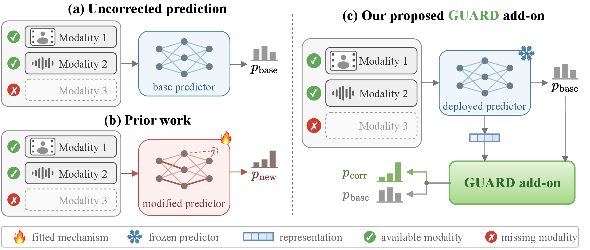
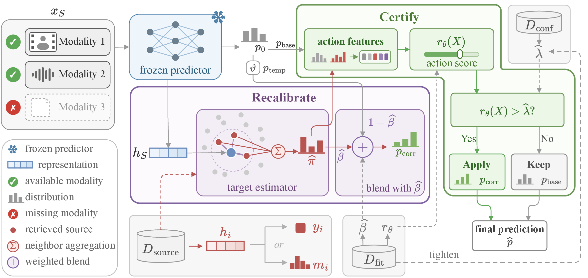

<div align="center">

# Gated Utility-Aware Recalibration for Deployment (GUARD)

**Risk-Controlled Correction for Frozen Multimodal Models under Missing Modalities**

[-b31b1b.svg)](#citation)
[](requirements.txt)
[](LICENSE)



</div>

GUARD corrects a deployed multimodal model that has lost some of its inputs, **without changing its weights**.
*Recalibrate* blends the frozen prediction with a retrieval estimate of the best prediction the observed modalities allow.
*Certify* applies this correction only where a learned action score clears a threshold calibrated by **conformal risk control**. Under exchangeability, the probability that GUARD applies a correction that raises the loss by more than δ is at most α.

## Method

<p align="center"></p>

## Quick start

```bash
pip install -r requirements.txt
bash data/download.sh mosei                  # saved outputs of the frozen models
python -m experiments.run_guard mosei        # GUARD on every condition
python -m experiments.compare_rules mosei    # intervention rules on one corrector
python -m experiments.synthetic              # controlled study, no download
pytest                                       # checks on synthetic data
```

Benchmarks: `mosei`, `iemocap`, `opportunity`, `ave`, `ninapro`, `ptbxl`, `drugban`. Use `--limit N` to run only the first N conditions and `--procs N` to run them in parallel. Data: see [`data/README.md`](data/README.md).

To use GUARD on your own frozen model, pass its saved outputs and four disjoint index sets:

```python
from guard import Condition, run

cond = Condition(probs, features, labels, split=(pool, fit, conf, test))
run(cond, alpha=0.2, delta=0.05)   # accuracy gain, joint harm and apply rate on the test rows
```

## Layout

```
guard/         the method: retrieval targets, action score, calibration
experiments/   benchmark loaders and the scripts above
data/          download script for the saved model outputs
tests/         checks on synthetic data
```

## Citation

```bibtex
@misc{phamcong2026guard,
  title  = {Risk-Controlled Correction for Frozen Multimodal Models under Missing Modalities},
  author = {Hoang Pham Cong and Long D. Nguyen and Ho Viet Duc Luong and Nguyen Tran Minh Nhat and Binh P. Nguyen and Huynh Thi Thanh Binh},
  year   = {2026}
}
```

## License

[MIT](LICENSE). The datasets and the frozen models keep their own licences.
